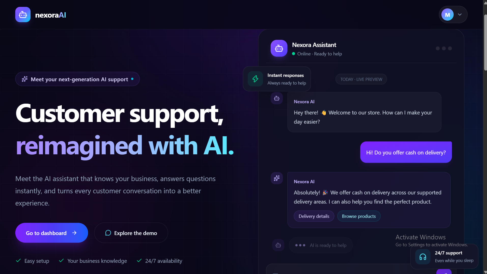
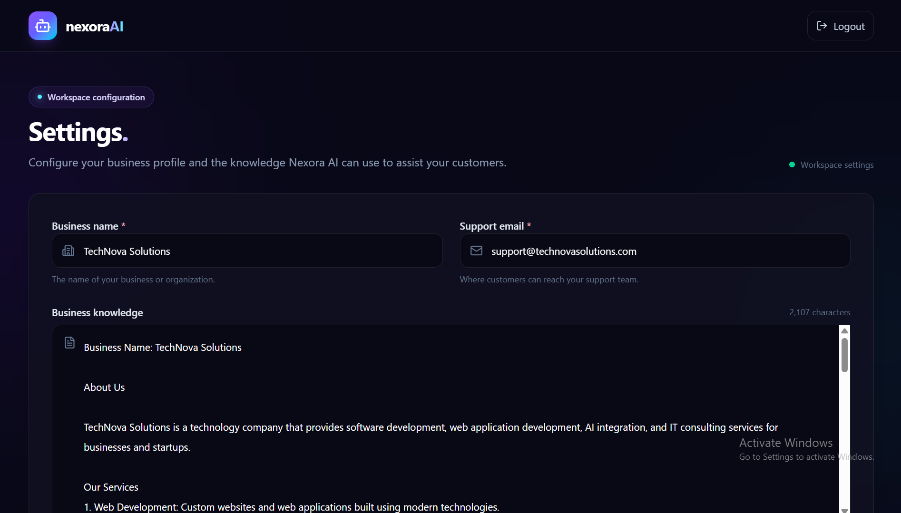
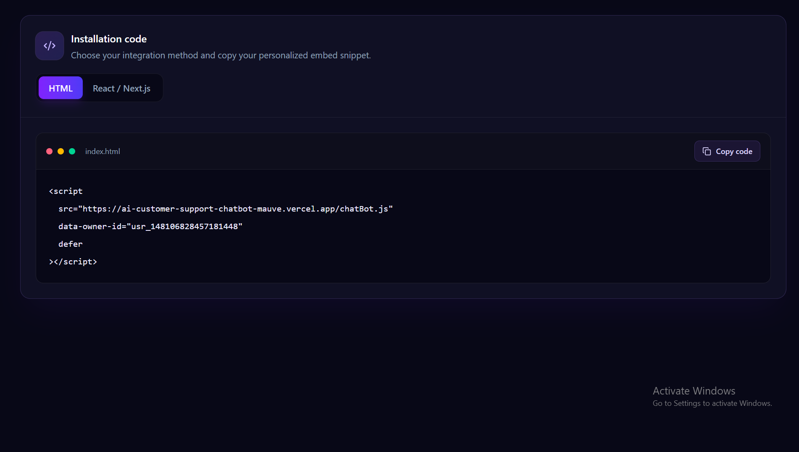
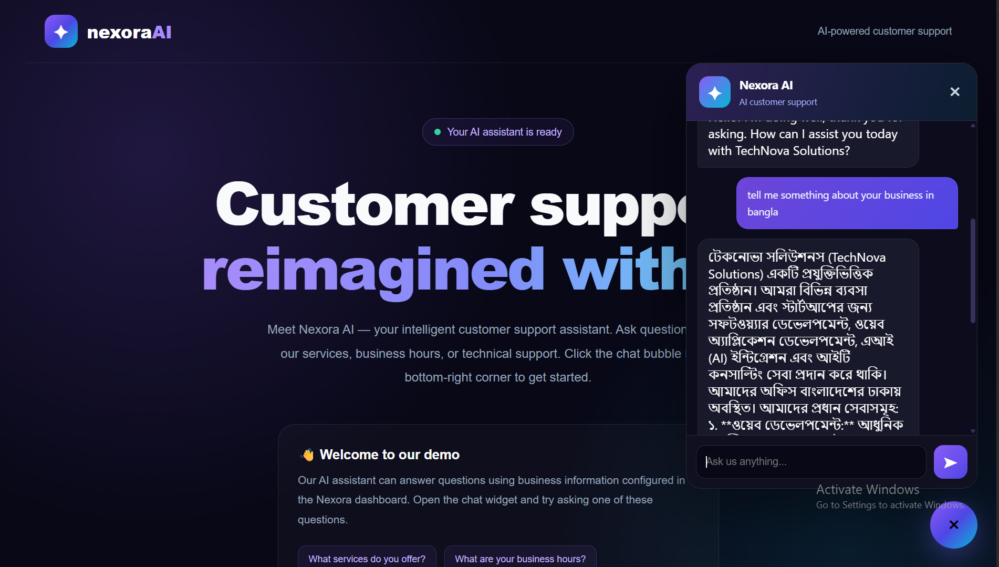

# ✨ Nexora AI — AI-Powered Customer Support Chatbot

\<p align="center">
&#x20; \<strong>Turn every website into an intelligent customer support experience.\</strong>
\</p>

\<p align="center">
&#x20; An AI-powered customer support platform that helps businesses deliver instant, personalized answers through an embeddable chatbot widget powered by Google Gemini.
\</p>


\<p align="center">
  
  
  
  
\</p>

---

## 📌 Overview

**Nexora AI** is a customizable AI customer support chatbot designed to help businesses automate customer conversations using their own business information.

Businesses can configure their business name, support email, and knowledge base. The chatbot uses that information to generate relevant responses and can be embedded into an external website with a simple JavaScript snippet.

Instead of building a separate chatbot for every business, Nexora AI uses a reusable widget connected to a centralized API.

### 🎯 Why Nexora AI?

- 🤖 **AI-Powered Conversations** — Generate natural-language responses using Google Gemini.
- 🏢 **Business-Specific Knowledge** — Customize answers using each business's information.
- 🌐 **Embeddable Chatbot Widget** — Integrate the chatbot into compatible websites with a script tag.
- ⚡ **Instant Responses** — Send customer messages to the API and display AI-generated replies.
- 🔧 **Easy Configuration** — Manage business details and support information.
- 🌍 **Multilingual Responses** — Instruct the AI to respond in the customer's language whenever possible.
- 🛡️ **Input Validation** — Validate incoming messages and required fields before processing.
- 🚀 **Cloud Deployment** — Deploy the Next.js application and API to a compatible hosting platform.

---

## ✨ Features

### 🤖 Intelligent Customer Support

The chatbot generates responses based on the business knowledge provided to the application.

It is instructed to:

- Answer using the supplied business information.
- Avoid inventing prices, policies, services, or contact details.
- Acknowledge when information is unavailable.
- Provide the configured support email when appropriate.
- Respond in the customer's language whenever possible.

### 🏢 Business Configuration

Each business can have its own configuration, including:

| Field          | Description                                  |
| -------------- | -------------------------------------------- |
| `ownerId`      | Identifies the business configuration        |
| `businessName` | Name of the business                         |
| `supportEmail` | Customer support email                       |
| `knowledge`    | Business-specific information used by the AI |

The configuration is stored in MongoDB using Mongoose.

### 🌐 Embeddable JavaScript Widget

The widget is designed to be integrated into external websites without requiring the website owner to rebuild their frontend.

Add a script tag to your HTML:

```html
<script
  src="https://ai-customer-support-chatbot-mauve.vercel.app/chatBot.js"
  data-owner-id="YOUR_BUSINESS_OWNER_ID"
  defer
></script>
```

### 🔌 Chat API

The API accepts a business identifier and customer message, retrieves the relevant business settings, and asks Google Gemini to generate a response.

**Example request:**

```http
POST /api/chat
Content-Type: application/json
```

```json
{
  "ownerId": "your-business-owner-id",
  "message": "What services do you offer?"
}
```

**Example response:**

```json
{
  "success": true,
  "message": "AI response generated successfully.",
  "data": {
    "reply": "We can help you with our available business services...",
    "businessName": "Your Business"
  }
}
```

The reply shown above is illustrative; the actual response depends on the business configuration and customer message.

### 🛡️ API Validation

The chat API includes:

- Required-field validation.
- Message length validation.
- Business configuration lookup.
- Gemini API key configuration checks.
- CORS response headers and preflight handling.
- Error handling for database and AI service failures.

> **Security note:** CORS is not authentication. Production deployments should implement rate limiting, abuse prevention, and appropriate authorization to protect business data and control AI usage costs.

---

## 🛠️ Tech Stack

| Technology                                                     | Purpose                              |
| -------------------------------------------------------------- | ------------------------------------ |
| [Next.js](https://nextjs.org/)                                 | Application framework and API routes |
| [React](https://react.dev/)                                    | User interface                       |
| [TypeScript](https://www.typescriptlang.org/)                  | Type-safe development                |
| [Tailwind CSS](https://tailwindcss.com/)                       | Styling and responsive UI            |
| [MongoDB](https://www.mongodb.com/)                            | Persistent data storage              |
| [Mongoose](https://mongoosejs.com/)                            | MongoDB object modeling              |
| [Google Gemini](https://ai.google.dev/)                        | AI-powered response generation       |
| [`@google/genai`](https://www.npmjs.com/package/@google/genai) | Google GenAI SDK                     |
| JavaScript                                                     | Embeddable chatbot widget            |
| [Vercel](https://vercel.com/)                                  | Application deployment               |

---

### How It Works

1. A business embeds the Nexora AI widget into its website.
2. The widget reads the business identifier from the script tag.
3. A customer sends a message through the chatbot.
4. The widget sends the message and business identifier to the Next.js API.
5. The API validates the request and retrieves the business configuration from MongoDB.
6. The application combines the business information with its AI instructions.
7. Google Gemini generates a response.
8. The API returns the response to the widget for display.

---


### Step 1: Configure Business Information

Create or update a business configuration with:

- A unique business identifier.
- Business name.
- Support email.
- Relevant business knowledge.

### Step 2: Make the Widget Publicly Accessible

Deploy the widget JavaScript file to a publicly accessible URL.

For example:

```text
https://ai-customer-support-chatbot-mauve.vercel.app/chatBot.js
```

Make sure the deployed file is served as JavaScript and can be loaded by external websites.

### Step 3: Add the Embed Script

Place the following snippet in the target website's HTML:

```html
<script
  src="https://ai-customer-support-chatbot-mauve.vercel.app/chatBot.js"
  data-owner-id="your-business-owner-id"
  defer
></script>
```

### Step 4: Test the Integration

1. Open the target website.
2. Confirm that the chatbot widget appears.
3. Send a test message.
4. Verify that the API returns a response for the intended business.
5. Check browser console and server logs if an error occurs.

---

## 🔐 Security Best Practices

Before using Nexora AI with real customers, consider implementing the following:

- **Rate limiting:** Limit requests by IP, business, and other suitable identifiers.
- **Authorization:** Do not treat a public `ownerId` as proof of ownership or permission.
- **Data isolation:** Ensure each business can only access its own protected configuration.
- **Input validation:** Validate request bodies and enforce size limits.
- **Abuse protection:** Prevent automated requests from exhausting AI quotas.
- **Secret management:** Keep Gemini and database credentials server-side.
- **CORS configuration:** Allow only the origins required by your deployment when practical.
- **Logging and monitoring:** Track errors, latency, usage, and unusual request patterns.
- **Prompt injection defenses:** Treat business knowledge and customer messages as untrusted input.

Remember that browser-based CORS restrictions do not prevent direct HTTP requests from scripts or other clients. Backend authorization and rate limiting are still necessary.

---


## 👨‍💻 Author

**Yeasin Riyad**

Building AI-powered applications and exploring modern web development, LLM integrations, and intelligent automation.

- GitHub: [@yeasin-riyad](https://github.com/yeasin-riyad)

---

\<p align="center">
&#x20; \<strong>✨ Nexora AI\</strong>
&#x20; \<br />
&#x20; Making customer support smarter, faster, and more accessible.
\</p>
